# Demo mode

The oscilloscope from the background of every science-fiction lab scene, on your bench. Demo mode
plays a looping show of what the RTB2 can do, using only the scope's own generators: a heartbeat
monitor, a signal glowing in noise, a radar ping, AM and FM, spectra, bursts, a live pass/fail mask
test, and with the logic probe connected, decoded I2C and SPI traffic and a logic-analyzer counter.

Use it for a video, a trade-show table, a club meeting, or to check that a scope and its options work.

## What you need

| Level | Wiring | Options used |
|---|---|---|
| **Analog** (8 scenes) | Aux Out -> 50 ohm feed-through terminator -> CH1 | B6 (generator) |
| **Full** (11 scenes) | Analog wiring, plus pattern generator P0, P1, P2, P3 -> logic probe D0, D1, D2, D3, and the probe's ground lead to the pattern generator's ground contact (upper left) | B6, B1 (logic probe), K1 (I2C/SPI decode) |

The 50 ohm terminator matters: the RTB2 inputs are 1 Mohm only, and the demo sets the generator to
drive a 50 ohm load. Without a terminator every amplitude is doubled. A short BNC cable and a BNC
feed-through terminator (50 ohm) are all the analog demo needs.

## Run it

From the command line (the scope accepts one LAN client at a time, so close other connections first):

```bash
uv run rs-scope --host <scope-ip> demo --level analog --list          # scenes and wiring
uv run rs-scope --host <scope-ip> demo --level analog --loops 0 --yes # loop until Ctrl-C
uv run rs-scope --host <scope-ip> demo --level full --dwell 15 --yes  # one pass, 15 s per scene
uv run rs-scope --host <scope-ip> demo --only heartbeat mask --yes    # just some scenes
uv run rs-scope --host <scope-ip> demo --level full --dwell 0 --shots shots/ --yes   # screenshots
```

From Claude, through the MCP server: "Run the full demo on the scope, 15 seconds per scene."
That calls `demo(action="start", level="full", dwell_s=15, confirm=true)`; `demo(action="stop")`
ends it. While the demo runs, other scope tools wait.

`--yes` (or `confirm=true`) is required because the demo switches on the generator and pattern
generator outputs. Before the first scene the complete setup is saved (`SYSTem:SET?`); when the demo
ends or is stopped (Ctrl-C), the setup is restored and the generators are off. The heartbeat waveform
is uploaded to the scope's internal storage as `RSHEART.CSV` and deleted again at the end.

## The scenes

| | Scene | What it shows |
|---|---|---|
| 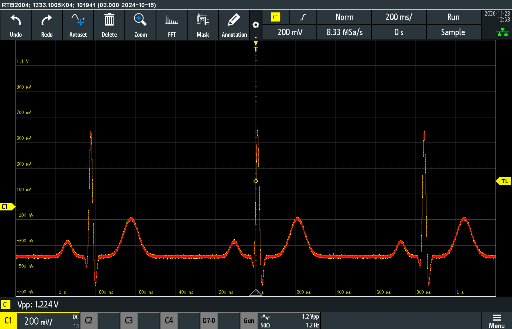 | **Vital signs** | A heartbeat at 72 bpm, played from the generator's arbitrary-waveform memory (the waveform is generated and uploaded by the demo) |
| 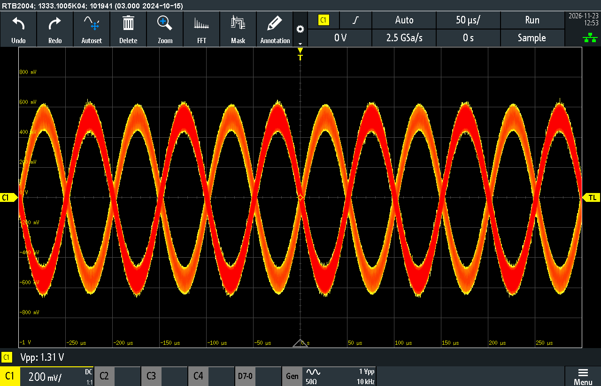 | **Signal in the noise** | A 10 kHz carrier with 25 % noise, intensity-graded ("fire") with persistence |
| 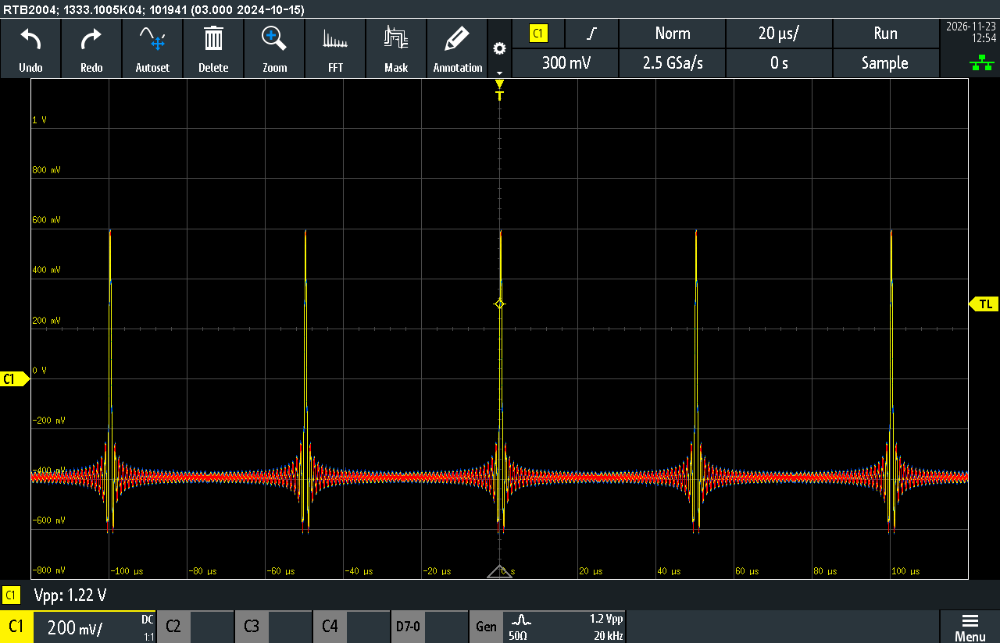 | **Radar ping** | A repeating sinc pulse, the shape of a band-limited radar or sonar ping |
| 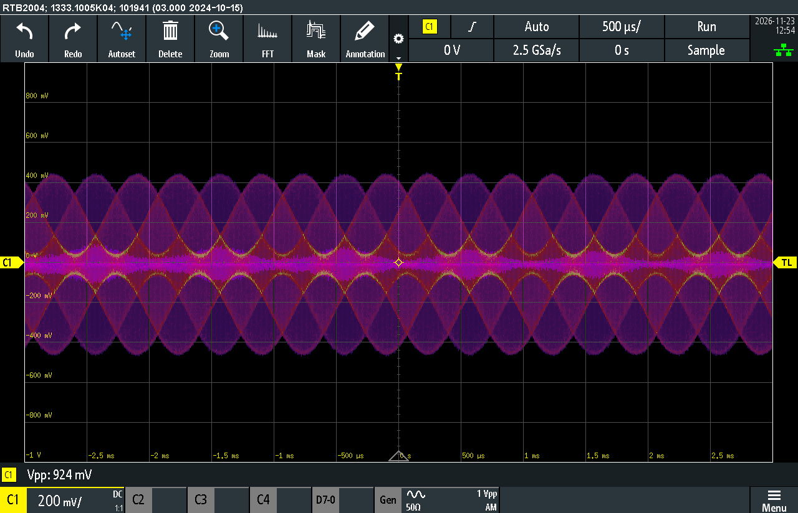 | **Amplitude modulation** | 100 kHz carrier, 1 kHz tone, 80 % depth |
| 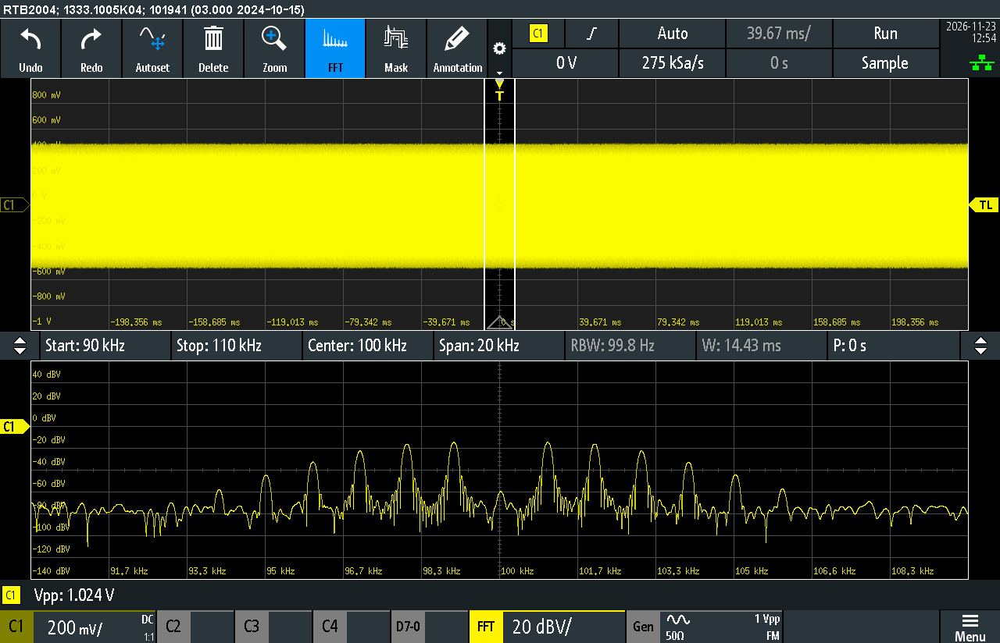 | **FM spectrum** | FM at 100 kHz with 2.4 kHz deviation: the Bessel sidebands on the spectrum analyzer |
| 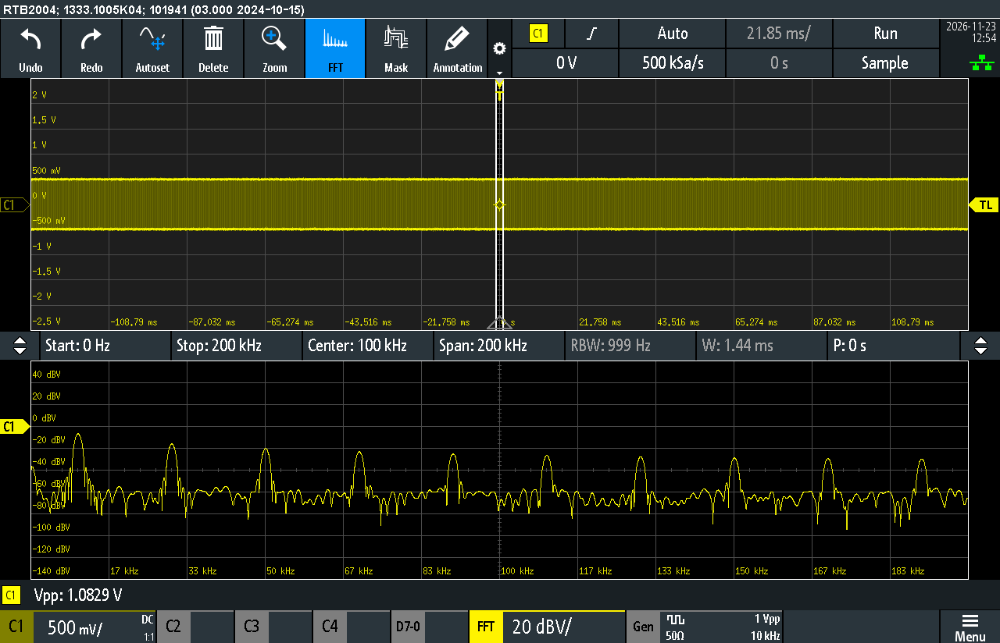 | **Harmonics** | A 10 kHz square wave and its odd harmonics |
| 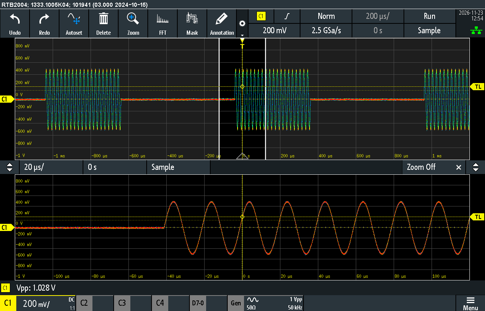 | **Burst** | Bursts of a 50 kHz sine with a zoom window on the leading edge |
| 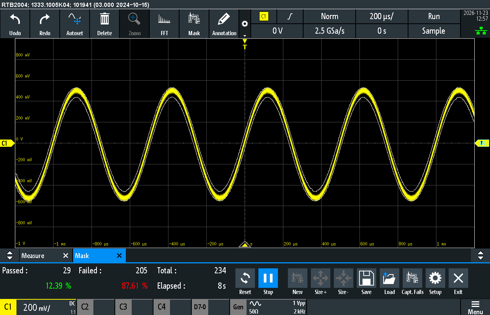 | **Pass / fail** | A tolerance mask learned from a clean sine; then noise arrives and the failure counter climbs |
| 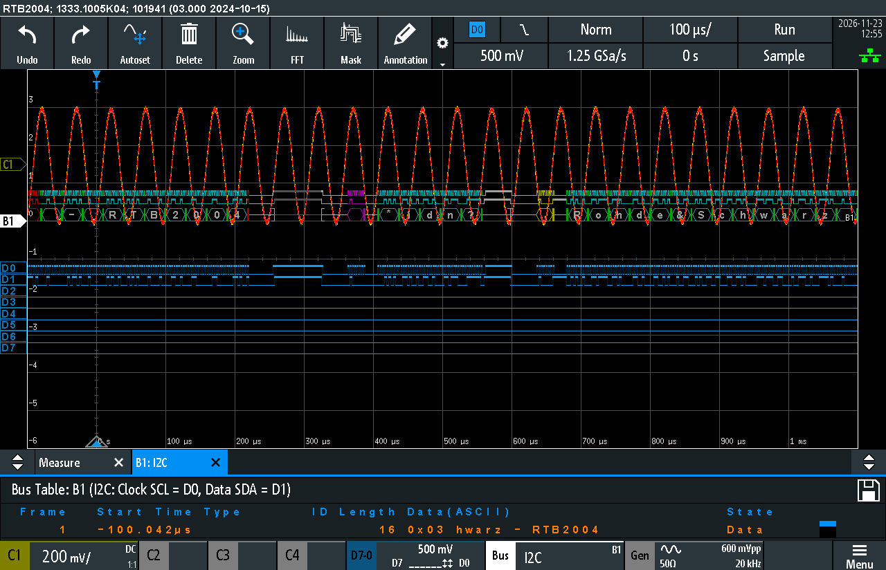 | **Bus traffic** (full) | I2C on D0/D1 decoded to text ("*idn?", "Rohde&Schwarz - RTB2004") next to a carrier on CH1 |
| 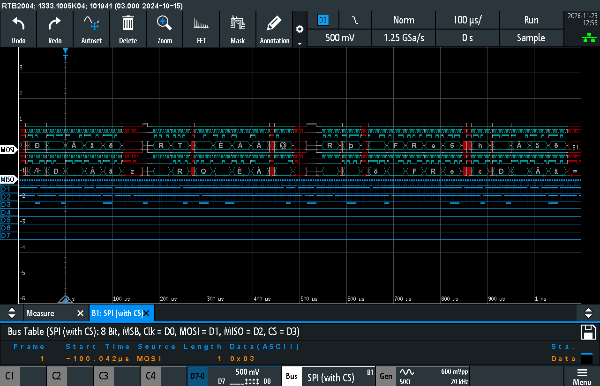 | **SPI link** (full) | Clock, MOSI, MISO and chip select on D0..D3, decoded as text |
| 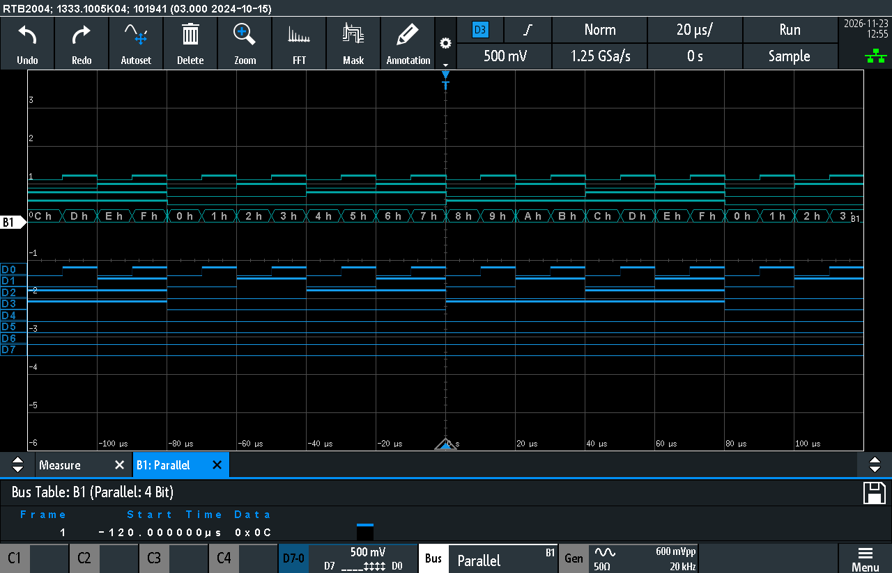 | **Logic analyzer** (full) | A 4-bit counter on D0..D3 decoded as a parallel bus |

## Notes from building it

- The arbitrary waveform only loads when the generator is already set to `ARB`
  (`WGEN:FUNC ARB`, then `WGEN:ARB:FILE:NAME`, then `WGEN:ARB:FILE:OPEN`); the other order gives
  `-200 Execution error`. The file format is the scope's own waveform CSV: a header line
  `in s,C1 in V`, then `time,value` rows.
- With noise on the signal, an edge trigger also fires on the falling slope where the noise briefly
  rises; the mask then looks 180 degrees off. The trigger's 5 kHz HF reject
  (`TRIG:A:EDGE:FILT:HFR ON`) fixes it.
- `MASK:TEST RUN` sometimes answers `-221 Settings conflict` after timebase changes. Turning the mask
  off, taking one single acquisition and learning the mask again clears it; the `mask` tool and the
  demo do that automatically.
- Two-dimensional pictures (a logo, a portrait) need an X/Y display with two analog sources. The
  generator has one output, so that is a separate setup (for example the stereo output of a computer
  into CH1 and CH2).
